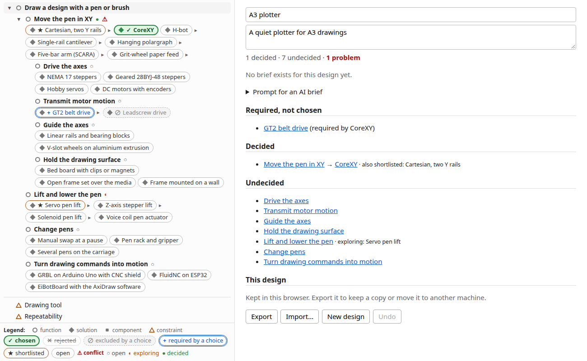
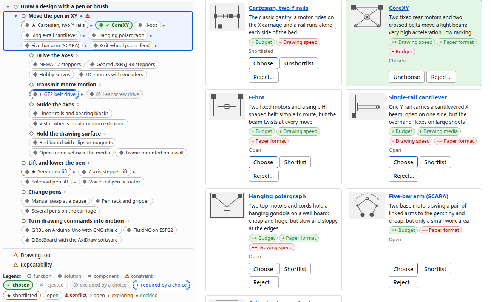

# Design space explorer

An LLM-maintained wiki of design decisions, stored as a graph of Markdown nodes. First topic: a DIY pen plotter.

## Layout

- `graph/`: one Markdown file per node, `links.jsonl` with all links, and `img/` with the optional pictures
- `tools/graph.py`: the tool that edits nodes and links
- `scripts/build-graph.mjs`: validates the nodes and compiles them to `graph.json`
- `graph.json`: compiled output (committed)
- `raw/`: source material (web pages, chats, notes). Git-ignored and never read by the build.

## Node format

The graph is a FAST-style tree of functions and solutions (what must be done, and how). A node is a Markdown file directly under `graph/` (subfolders are rejected) with YAML frontmatter and a free prose body. Its id is the frontmatter `id`: 8 lowercase hex characters, unique in the graph, written in quotes. The file name means nothing to the graph (the tool creates `graph/<slug>.md`). Links are not in the node file; they live in `graph/links.jsonl`.

```markdown
---
id: "861c9946"
title: CoreXY
type: solution
sources: ["LLM:claude-sonnet"]
confidence: low
summary: Two fixed motors and crossed belts move a light beam
abbr: COXY
---
Why it would be chosen, the tradeoffs, and why each link to it exists.
```

| Field | Required | Notes |
| --- | --- | --- |
| `id` | yes | 8 lowercase hex characters, quoted |
| `title` | yes | |
| `type` | yes | `function`, `solution`, `component` or `constraint` |
| `sources` | yes | non-empty list of free text: a URL, `user`, or `LLM:<model>` |
| `confidence` | no | `low`, `medium` or `high`; use `low` for unchecked LLM content |
| `summary` | no | one line (at most 120 characters) saying what the node is; shown on its card. `graph.py lint` asks for one on every solution and component |
| `abbr` | no | 1 to 4 letters or digits for the picture tile of a node without a picture; the default is derived from the title (`NEMA 17 steppers` gives `N17S`) |

`slot`, `parent`, `requires`, `excludes` and `compatible_with` are not allowed in the frontmatter: the build fails if it finds them.

**Pictures.** A node may have a picture: a monochrome SVG at `graph/img/<id>.svg` (named by id, so a retitle keeps it; at most 50 kB). The build fails on any other file in `graph/img/` and sets `img: true` on the nodes that have one. The viewer shows it through ``, so a picture can never run script. Style, so the pictures look like a set: `viewBox="0 0 120 90"`, `stroke="#555"`, `stroke-width="2"`, `fill="none"` (the same grey may fill a motor), no `<text>`, a schematic top view of the mechanism. Nodes without a picture get a tile with their abbreviation.

The root is the **main function**: the one function with no "why". Constraint nodes hold prose only: the kind of limit and how solutions fare. Values such as a paper format or a price belong to design documents, not to the graph.

## Links file

`graph/links.jsonl` holds every link, one JSON object per line:

```
{"from":"861c9946","to":"b3a8fe22","type":"how","src":"user","hint":"CoreXY > Transmit motor motion"}
```

| Field | Notes |
| --- | --- |
| `from`, `to` | node ids |
| `type` | `how`, `constrains`, `requires`, `excludes`, `compatible_with` or `fares` (below) |
| `order` | `how` links only, optional integer: position of the target among the source's children (per parent). Display order, e.g. 1 = most common or recommended |
| `score` | `fares` links only, required: -2, -1, 1 or 2 (never 0: no link means neutral) |
| `src` | who or what made the link: free text, like node `sources` (`user`, `LLM:<model>`, ...) |
| `hint` | titles for people reading `git diff`; written by the tool, ignored by the build |

- `how` goes from the "why" end to the "how" end, and its meaning comes from the node types: function to function is a sub-function (AND), function to solution is an alternative (OR), solution to function is a sub-function the solution brings (AND), solution to component is a part. A function's `how` targets are all functions or all solutions. A node may have several whys (a shared sub-function). Exactly one function has no why (the root), every function, solution and component must reach it, no cycles.
- `constrains` goes from a constraint to a function it limits. A constraint has no `how` links.
- `requires` (the target must also be selected), `excludes` (cannot be selected together, symmetric in the output) and `compatible_with` (informational) join solutions and components only.
- `fares` goes from a solution or component to a constraint and says how it does against it: `score` -2 (much worse), -1, 1, 2 (much better). The score is relative to the alternatives under the same function, not absolute, and the node's body should say why. It is informational (it never restricts a choice) and shows as a badge on the card (`++ Drawing speed`, `− Budget`).

Canonical form: lines sorted by `type`, `from`, `to`, keys in the order `from`, `to`, `type`, `order`, `score`, `src`, `hint`, compact JSON, no duplicate (`type`, `from`, `to`). The build accepts any valid order; `tools/graph.py format` restores it. Don't edit the file by hand: use the tool below, so every change is one readable line in `git diff`.

`graph.json` has a top-level `root` id and, for each node, `why` and `how` (`why` in file order; `how` sorted by the links' `order`, then links without `order` by title, so the author's order is the display order), `constrains` and `constrained_by` (always present), and `requires`, `excludes`, `compatible_with`, and `fares` (a list of `{id, score}` sorted by id, always present), plus `img: true` on a node with a picture. Nodes are sorted by id.

## Editing the graph

`tools/graph.py` (Python 3, standard library only) is the one way to edit nodes and links. Python is only needed to edit the graph, not to build or view it. Nodes are given by id or by a unique prefix of it.

```sh
python3 tools/graph.py new "Draw on paper" --type function --source user          # the first function is the root
python3 tools/graph.py new "Rack and pinion" --type solution --why b3a8 --source "LLM:claude-sonnet" --confidence low --summary "A gear on a toothed rack"
python3 tools/graph.py new "Paper format" --type constraint --constrains b3a8
python3 tools/graph.py link <new id> --requires e67a --src "LLM:claude-sonnet"
python3 tools/graph.py link <new id> --fares 9dbd --score -1 --src "LLM:claude-sonnet"   # costs more than its siblings (linking again rescores)
python3 tools/graph.py link f196 --how <new id>           # a second why for a node
python3 tools/graph.py unlink f196 --how <new id>
python3 tools/graph.py order b3a8 <child> <child> ...     # children of b3a8 in that order (1..n); unlisted children lose their order
python3 tools/graph.py link b3a8 --how <new id> --order 2 # or set the position of one new link
python3 tools/graph.py tree     # how tree from the root in author order, [AND] / [OR] / [part] / [constraint] labels, repeats marked
python3 tools/graph.py lint     # prints findings, exit 1 if any, writes nothing
python3 tools/graph.py format   # rewrite links.jsonl canonically, refresh hints
```

`new` needs `--type` and a `--why` (repeatable; `--constrains` for a constraint), so no node is born unreachable; only the first function of an empty graph may have none. `--summary` takes one line of at most 120 characters. It prints the id and writes `graph/rack-and-pinion.md` (body empty, to be written) and its links. `link` refuses duplicates, `how` cycles, type pairs the format forbids and a function that would get both function and solution targets. `lint` reports redundant `how` links (already implied through another path), nodes unreachable from the root, `requires` together with `excludes` on the same pair, functions with mixed function and solution children, constraints with no `constrains` link, parents whose how children are only partly ordered, solutions and components with no `summary`, and stale hints (run `format` after renaming a node). The build is still the full validator: run `npm run build` after editing. Tests: `python3 -m unittest discover tools`.

## Build

```sh
npm install
npm run build   # graph/ -> graph.json
npm test
```

The build prints every error and writes nothing if validation fails.

## Viewer

A static page (plain HTML and ES modules, no build step) to browse the graph and build a design from it.

```sh
npm run build   # refresh graph.json
npm run serve   # prints http://localhost:8080/viewer/ (pass a port: npm run serve -- 9000)
```



One full-width page, no tabs, no top bar and no modal:

- **Left panel (graph)**: the design tree: one line per function with a type icon and a status mark (`○` open, `◐` exploring, `●` decided), its solutions as **chips** on the line in the author's order, and the constraint nodes after the tree, and a **legend** pinned to the bottom of the panel. A chip shows its state in the design by a mark as well as colour: `✓` chosen, `★` shortlisted, `✕` rejected, `⊘` excluded by a chosen solution, `+` required by a chosen solution, `⚠` for a choice in conflict; the tooltip names the cause. Below a function only its **chosen** solution's sub-functions and components are listed. `▸` next to a chip **peeks** at what that solution brings (listed dormant, in italics; one peek per function), `▾` next to a function line **collapses** it (the line then shows how many lines are hidden). A function reached through several solutions is repeated, with its children listed once. Clicking a line or a chip only **opens** the node; it never changes the design.
- **Right panel**: the open node, or, with none open (`×` or Esc), the design overview.
  - **Node panel**: breadcrumb (the path through your choices, else the first why), title, a card header for a solution or component (picture or tile, summary, badges), and a **Details** disclosure with the text and sources (collapsed when the node has a summary, open when it has none), context (why, other solutions), implications (brings, requires, excludes, constrained by), its state in your design, a **what-if** preview for a solution you have not chosen (what it replaces, brings in, drops, requires, conflicts with), then the edit controls: **Choose / Unchoose**, **Shortlist / Unshortlist**, **Reject…** (asks for a reason) / **Unreject** on a solution, a notes field on a function (which also shows its solutions as cards with the same buttons), a value field on a constraint, and **Undo**.
  - **Cards**: a function shows its solutions as a grid of cards, in the author's order: picture or abbreviation tile, title, summary, tradeoff badges (`++ Drawing speed` good, `− Budget` bad, from the `fares` links; hover for the score in words), the state in your design and the Choose / Shortlist / Reject buttons. A constraint lists the solutions that do well and badly on it.
  - **Overview**: the design's name and intent (editable), counts (decided, undecided, problems), the brief or the prompt box, conflicts, required-but-not-chosen solutions, decided and undecided functions, and **Export**, **Import…**, **New design** and **Undo**.



### The design document

Your design is one JSON document, separate from the graph and from the URL: id, name, intent, a value for each constraint you care about, and per function a `status` (`open`, `exploring`, `decided`), a `choice`, a `shortlist`, `rejected` solutions with a reason, and `notes`. It changes only through the buttons above, is saved in the browser's `localStorage` after every edit, and can be undone (back to when the page was opened; the history is not kept across reloads).

```json
{ "format": 1, "id": "d-3f9a1c2e", "name": "My plotter", "intent": "A quiet A3 plotter",
  "constraints": { "2cc55003": "A4, sometimes A3" },
  "functions": { "854ac5e5": { "status": "decided", "choice": "1f4df7b0",
    "shortlist": ["2e099434"], "rejected": [{ "id": "a316aecc", "reason": "too wobbly" }], "notes": "" } } }
```

- A solution can only be chosen, shortlisted or rejected under a function it belongs to; one choice per function. Choosing an excluded solution is allowed and shows as a conflict. Entries of functions that are not reached by your choices are kept, and count again when they are.
- **Export** downloads `<name>.design.json`; **Import…** replaces the current design with such a file (undoable). Unknown node ids and invalid entries are dropped, with a notice naming them; a file that is not a design is refused. Use this to keep a copy or move a design between browsers.
- If browser storage is blocked, the page works with the design in memory and says it will not be kept.

The URL hash holds the view only, so reload, sharing and the back button work: `#/?view=<id>&fold=<id>,<id>&peek=<id>,<id>` (open node, collapsed functions, peeked solutions). Old forms still open the page: `#/design`, `#/graph`, `#/selection` and `#/browse/<node-id>` (as `view=<node-id>`); a `pick=` list is ignored with a notice, since choices now live in the design. Unknown ids in the hash are ignored with a notice.

## Briefs

The viewer makes no LLM calls. A written brief for a design comes from an AI outside the page:

1. Build a design, expand "Prompt for an AI brief" in the overview and press "Copy prompt".
2. Paste it into any AI and save its answer as a Markdown file, e.g. `brief.md`.
3. Press **Export** and store the brief for that design file: `npm run brief -- save my-plotter.design.json brief.md --model <model name>`.

Reload the page: the brief is shown in the overview with the model name.

Cache layout: `briefs/<design id>.md` (frontmatter `design_id`, `design_name`, `content_hash`, `model`, `prompt_version`, `created`, then the Markdown) and `briefs/index.json` mapping each design id to its file. The brief stays attached to the design while you edit it; saving again for the same design replaces it. `save` fails, and writes nothing, if the design file names a node that is not in `graph.json` or holds an entry that does not fit it. The prompt template is `prompts/brief.md`.

A brief is marked **stale** when the design changed after it was saved (a choice, shortlist, rejection, note, constraint value, name or intent), or when the title, body, sources, `requires` or `excludes` of a chosen node changed. Opening, collapsing and peeking never make it stale. The prompt box is then shown again so a new brief can be made. A New design has no brief.
