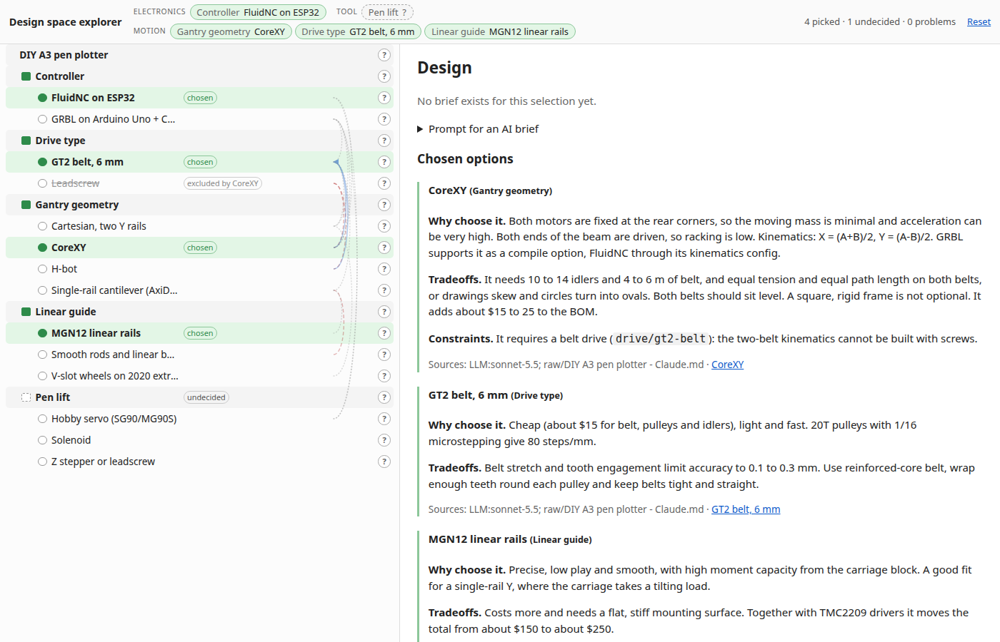
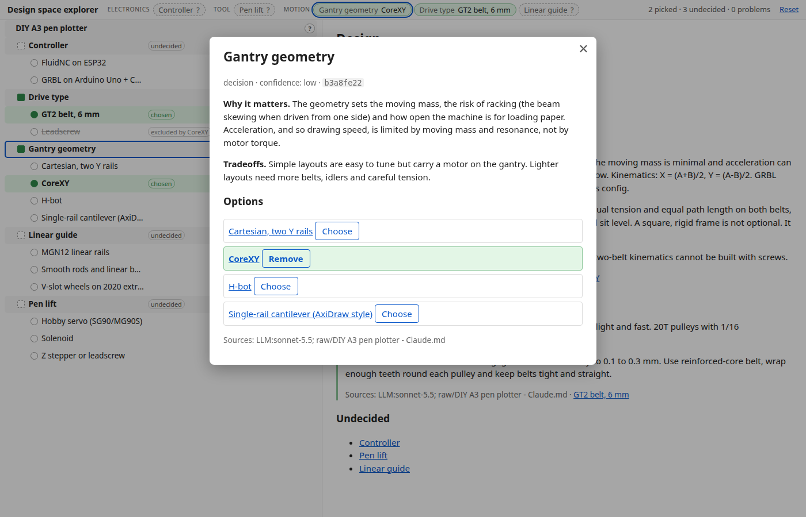

# Design space explorer

An LLM-maintained wiki of design decisions, stored as a graph of Markdown nodes. First topic: a DIY A3 pen plotter.

## Layout

- `graph/`: one Markdown file per node, and `links.jsonl` with all links
- `tools/graph.py`: the tool that edits nodes and links
- `scripts/build-graph.mjs`: validates the nodes and compiles them to `graph.json`
- `graph.json`: compiled output (committed)
- `raw/`: source material (web pages, chats, notes). Git-ignored and never read by the build.

## Node format

A node is a Markdown file under `graph/` with YAML frontmatter and a free prose body. Its id is the frontmatter `id`: 8 lowercase hex characters, unique in the graph, written in quotes. The file name and folder mean nothing to the graph (new files are created flat as `graph/<slug>.md`). Links are not in the node file; they live in `graph/links.jsonl`.

```markdown
---
id: "861c9946"
title: CoreXY
type: option
sources: ["LLM:sonnet-5.5"]
confidence: low
---
Why it would be chosen, the tradeoffs, and why each link to it exists.
```

| Field | Required | Notes |
| --- | --- | --- |
| `id` | yes | 8 lowercase hex characters, quoted |
| `title` | yes | |
| `type` | yes | `root`, `decision`, `option` or `component` |
| `sources` | yes | non-empty list of free text: a URL, `user`, or `LLM:<model>` |
| `confidence` | no | `low`, `medium` or `high`; use `low` for unchecked LLM content |
| `slot` | no | groups decisions in the diagram |

`parent`, `requires`, `excludes` and `compatible_with` are not allowed in the frontmatter: the build fails if it finds them.

## Links file

`graph/links.jsonl` holds every link, one JSON object per line:

```
{"from":"861c9946","to":"b3a8fe22","type":"parent","src":"user","hint":"CoreXY > Gantry geometry"}
```

| Field | Notes |
| --- | --- |
| `from`, `to` | node ids; `parent` goes from the child to its parent |
| `type` | `parent` (a node may have several; exactly one `root`, every node must reach it, no cycles), `requires` (the target must also be selected), `excludes` (cannot be selected together, symmetric in the output), `compatible_with` (informational) |
| `src` | who or what made the link: free text, like node `sources` (`user`, `LLM:<model>`, ...) |
| `hint` | titles for people reading `git diff`; written by the tool, ignored by the build |

Canonical form: lines sorted by `type`, `from`, `to`, keys in the order above, compact JSON, no duplicate (`type`, `from`, `to`). The build accepts any valid order; `tools/graph.py format` restores it. Don't edit the file by hand: use the tool below, so every change is one readable line in `git diff`.

`graph.json` gives each node `parents` (in file order) and `children` (by title); `parent` is the first parent, which the viewer uses.

## Editing the graph

`tools/graph.py` (Python 3, standard library only) is the one way to edit nodes and links. Python is only needed to edit the graph, not to build or view it. Nodes are given by id or by a unique prefix of it.

```sh
python3 tools/graph.py new "Rack and pinion" --parent b3a8 --source "LLM:sonnet-5.5" --confidence low
python3 tools/graph.py link <new id> --requires e67a --src "LLM:sonnet-5.5"
python3 tools/graph.py link <new id> --parent f196        # a second parent
python3 tools/graph.py unlink <new id> --parent f196
python3 tools/graph.py tree     # indented outline, repeats marked
python3 tools/graph.py lint     # prints findings, exit 1 if any, writes nothing
python3 tools/graph.py format   # rewrite links.jsonl canonically, refresh hints
```

`new` prints the id and writes `graph/rack-and-pinion.md` (body empty, to be written) and its `parent` links. `link` refuses duplicates and parent cycles. `lint` reports redundant parent links (already implied through another parent), nodes without a parent, `requires` together with `excludes` on the same pair, and stale hints (run `format` after renaming a node). The build is still the full validator: run `npm run build` after editing. Tests: `python3 -m unittest discover tools`.

## Build

```sh
npm install
npm run build   # graph/ -> graph.json
npm test
```

The build prints every error and writes nothing if validation fails.

## Viewer

A static page (plain HTML and ES modules, no build step) to browse the graph and try combinations of options.

```sh
npm run build   # refresh graph.json
npm run serve   # prints http://localhost:8080/viewer/ (pass a port: npm run serve -- 9000)
```



One full-width page, no tabs:

- **Top bar**: a compact selection summary. Decisions are grouped by `slot` (decisions without one go to "Other"), one pill each showing the chosen option or `?`; a pill opens its decision. Pills turn red on a conflict and amber on a missing requirement. Counts of picked options, undecided decisions and problems, and **Reset**.
- **Left panel (graph)**: the whole graph as an indented outline, one fixed-height line per node, indentation encodes depth. A node with several parents is repeated, with its children listed once. Right of the names, three lanes aligned across all lines: **state tags** (`chosen`, `excluded by X`, `undecided`, `needs X`, `needed by X`, `conflict`), a **link lane** where curves join the lines of linked nodes (`requires` with an arrow, `excludes` red dashed, `compatible_with` dotted; faint, lit for the open or hovered line), and a **`?` button** that opens the node. Clicking an option's line **toggles** it (one option per decision; an option excluded by the selection is disabled and names the cause). Clicking a decision opens it.
- **Right panel (main view)**: the brief or prompt box, conflicts, required-but-unselected options, the chosen options with their text, and undecided decisions.
- **Node modal** over the page (Esc, `×` or a click outside closes it): text, sources, `requires`/`excludes`/`compatible_with` links, a select/remove button for an option, and for a decision its options with Choose buttons.



The selection and the open node live in the URL hash, so reload, sharing and the back button work: `#/?pick=<id>,<id>&view=<id>`, e.g. `#/?pick=861c9946,e67a2f12&view=18f0f7e8`. Old forms still open the page: `#/design`, `#/graph`, `#/selection`, and `#/browse/<node-id>` (as `view=<node-id>`).

An optional `slot` field on a node (a non-empty string, e.g. `slot: Motion`) groups decisions in the top bar.

Unknown ids in the hash are ignored with a notice.

## Briefs

The viewer makes no LLM calls. A written brief for a selection comes from an AI outside the page:

1. Select a combination, expand "Prompt for an AI brief" and press "Copy prompt".
2. Paste it into any AI and save its answer as a Markdown file, e.g. `brief.md`.
3. Store it: `npm run brief -- save 861c9946,e67a2f12 brief.md --model <model name>`.

Reload the page: the brief is shown at the top of the main view with the model name.

Cache layout: `briefs/<key>.md` (frontmatter `pick`, `content_hash`, `model`, `prompt_version`, `created`, then the Markdown) and `briefs/index.json` mapping each selection key to its file. The key does not depend on the order of the ids. Saving again for the same selection replaces the brief. The prompt template is `prompts/brief.md`.

A brief is marked **stale** when the title, body, sources, `requires` or `excludes` of a selected node changed after it was saved. The prompt box is then shown again so a new brief can be made. Changes to unrelated nodes do not matter.
