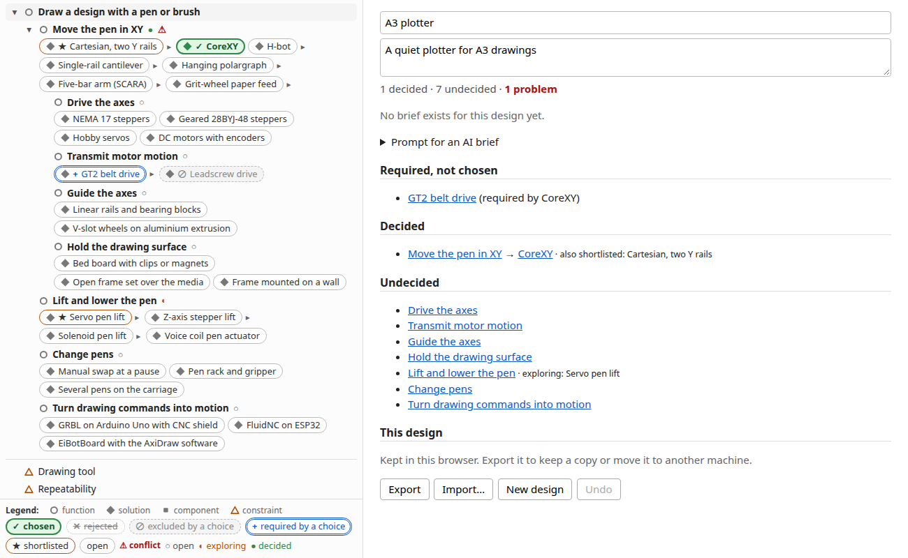
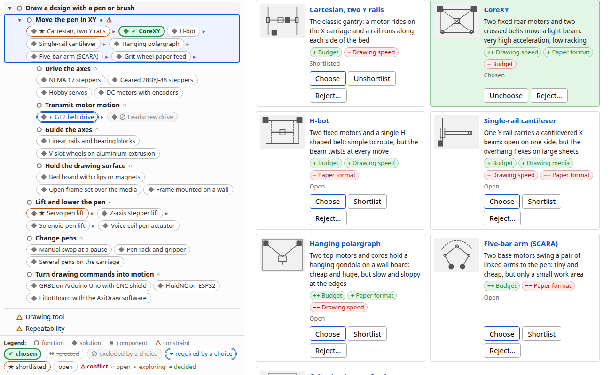

# Viewer

A static page (plain HTML and ES modules, no build step) to browse the graph and build a design from it.

```sh
npm run build   # refresh topics/pen_plotter/graph.json
npm run serve   # prints http://localhost:8080/viewer/ (pass a port: npm run serve -- 9000)
```

The viewer shows the `pen_plotter` topic; add `?topic=<name>` to open another one (`/viewer/?topic=<name>`). The server never serves `topics/*/raw/`.



One full-width page, no tabs, no top bar and no modal:

- **Left panel (graph)**: the design tree: one line per function with a type icon and a status mark (`○` open, `◐` exploring, `●` decided), its solutions as **chips** on the line in the author's order, and the constraint nodes after the tree, and a **legend** pinned to the bottom of the panel. A chip shows its state in the design by a mark as well as colour: `✓` chosen, `★` shortlisted, `✕` rejected, `⊘` excluded by a chosen solution, `+` required by a chosen solution, `⚠` for a choice in conflict; the tooltip names the cause. Below a function only its **chosen** solution's sub-functions and components are listed. `▸` next to a chip **peeks** at what that solution brings (listed dormant, in italics; one peek per function), `▾` next to a function line **collapses** it (the line then shows how many lines are hidden). A function reached through several solutions is repeated, with its children listed once. Clicking a line or a chip only **opens** the node; it never changes the design.
- **Right panel**: the open node, or, with none open (`×` or Esc), the design overview.
  - **Node panel**: breadcrumb (the path through your choices, else the first why), title, a card header for a solution or component (picture or tile, summary, badges), and a **Details** disclosure with the text and sources (collapsed when the node has a summary, open when it has none), context (why, other solutions), implications (brings, requires, excludes, constrained by), its state in your design, a **what-if** preview for a solution you have not chosen (what it replaces, brings in, drops, requires, conflicts with), then the edit controls: **Choose / Unchoose**, **Shortlist / Unshortlist**, **Reject…** (asks for a reason) / **Unreject** on a solution, a notes field on a function (which also shows its solutions as cards with the same buttons), a value field on a constraint, and **Undo**.
  - **Cards**: a function shows its solutions as a grid of cards, in the author's order: picture or abbreviation tile, title, summary, tradeoff badges (`++ Drawing speed` good, `− Budget` bad, from the `fares` links; hover for the score in words), the state in your design and the Choose / Shortlist / Reject buttons. A constraint lists the solutions that do well and badly on it.
  - **Overview**: the design's name and intent (editable), counts (decided, undecided, problems), the brief or the prompt box, conflicts, required-but-not-chosen solutions, decided and undecided functions, and **Export**, **Import…**, **New design** and **Undo**.



## The design document

Your design is one JSON document, separate from the graph and from the URL: id, name, topic, intent, a value for each constraint you care about, and per function a `status` (`open`, `exploring`, `decided`), a `choice`, a `shortlist`, `rejected` solutions with a reason, and `notes`. It changes only through the buttons above, is saved in the browser's `localStorage` after every edit, and can be undone (back to when the page was opened; the history is not kept across reloads).

```json
{ "format": 1, "topic": "pen_plotter", "id": "d-3f9a1c2e", "name": "My plotter", "intent": "A quiet A3 plotter",
  "constraints": { "2cc55003": "A4, sometimes A3" },
  "functions": { "854ac5e5": { "status": "decided", "choice": "1f4df7b0",
    "shortlist": ["2e099434"], "rejected": [{ "id": "a316aecc", "reason": "too wobbly" }], "notes": "" } } }
```

- A solution can only be chosen, shortlisted or rejected under a function it belongs to; one choice per function. Choosing an excluded solution is allowed and shows as a conflict. Entries of functions that are not reached by your choices are kept, and count again when they are.
- **Export** downloads `<name>.design.json`; **Import…** replaces the current design with such a file (undoable). Unknown node ids and invalid entries are dropped, with a notice naming them; a file that is not a design, or that names another `topic`, is refused (the design is unchanged). The `topic` field is optional on import; older files without it are taken as belonging to the current topic. The saved design is kept per topic in `localStorage` (`dse.design.<topic>`). Use this to keep a copy or move a design between browsers.
- If browser storage is blocked, the page works with the design in memory and says it will not be kept.

## URL hash

The URL hash holds the view only, so reload, sharing and the back button work: `#/?view=<id>&fold=<id>,<id>&peek=<id>,<id>` (open node, collapsed functions, peeked solutions). Old forms still open the page: `#/design`, `#/graph`, `#/selection` and `#/browse/<node-id>` (as `view=<node-id>`); a `pick=` list is ignored with a notice, since choices now live in the design. Unknown ids in the hash are ignored with a notice.

Briefs for a design are described in [Briefs](briefs.md).
